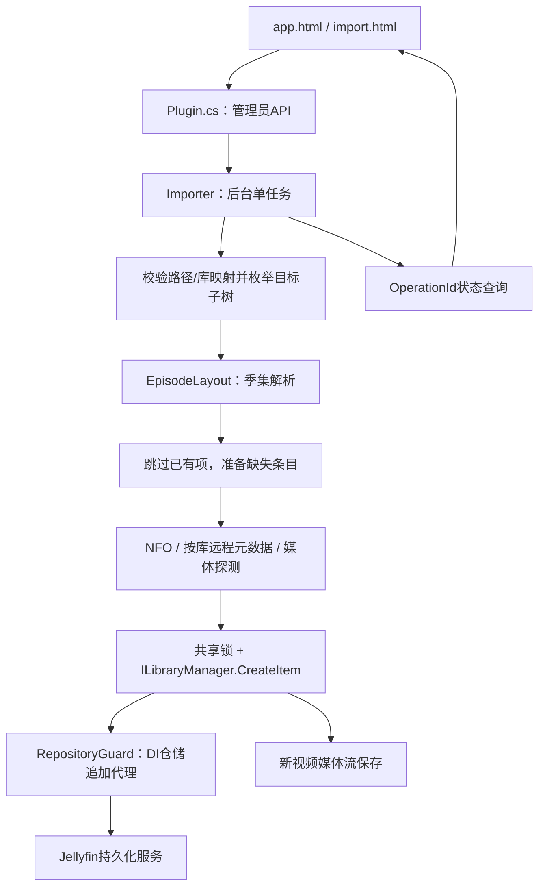

# 当前技术状态

更新：2026-10-14。阶段：旧工程已按授权退役，正式工程为唯一活跃开发项目；旧根仅保留生产备份原件。退役验收状态通过本次文档收尾提交同步至现有GitHub私有main。目标：[gok2023/jellyfin-scoped-import](https://github.com/gok2023/jellyfin-scoped-import)。未创建正式Release，未部署或访问生产。

## 版本、许可与维护范围

正式源码在 src/ScopedImport；插件程序集0.2.0.0，GUID 347d2c09-78a1-4697-9c3d-e23566122144。仅支持Windows / 原版Jellyfin10.11.11.0 ABI及BaseItemRepository。

作者决定采用 **GPL-3.0-only**，见LICENSE及THIRD_PARTY_NOTICES。不得把未知来源素材声明为作者原创；历史贡献/摘录记录不完整，未发现具体授权冲突，来源确认仍为待办。如发现实质冲突暂停相应分发。第三方版权和各自许可保留，不被本项目许可替换。

维护源码、脚本、测试、工具、文档及根构建配置；当前版本不是永久上限，未来升级按AGENTS验证并同步版本、依赖、文档。旧工程的历史源码、产物和实验状态已转存仓库之外的私有归档，不是构建依赖；原旧根仅保留生产备份，不再作为开发或安装入口。

## 架构

插件运行在Jellyfin内，无Python常驻助手。Python/Node仅作测试工具；媒体探测由宿主编码器驱动，可能启动ffprobe。App允许匿名取页面，入库/库信息/状态/审计API要求管理员。FetchMetadata优先，保留FetchTmdb兼容；202只代表排队，操作状态在内存中，重启丢失。

## 安全边界和技术决策

- 已初始化movies/tvshows库；完整本地Windows路径。拒绝库根、UNC、越界、链接/重解析点及歧义布局。
- 单片电影目录一个主视频；剧集支持NFO、SxxEyy、E01子目录。无季号按第一季，但已有其他季的歧义会拒绝。ISO/STRM/光盘/复杂多版不支持。
- 只处理新对象的元数据，不走完整刷新、远程海报或演员创建。既有项按路径/类型/父级核对并跳过，部分成功不自动回滚；重试不自动修补已创建项。
- 枚举深度8、10000项、120秒；任务15分钟、探测60秒、提供器30秒为软时限。
- 标准Updated通知可能回溯父级，完整刷新会改旧项；“先查不存在再CreateItem”仍有upsert竞争。当前共享仓储锁/追加上下文复查替代盲目创建；不直接写数据库。
- 代理不是系统沙箱或数据库唯一约束；第三方绕过仓储/替换服务、合法后台扫描和不响应取消的I/O不受完整约束。无全进程I/O证明。
- 客户端0.1.1和某条0.1错误提示为保留的历史标识，不是程序集版本。App静态提示现已区分历史隔离验证与新工程离线验证；没有改变页面脚本或入库逻辑。

## 工程与构建

- 仅迁移七项正式文件和当前有效测试。四业务C#未变；HTML仅占位路径脱敏和必要验证说明；csproj仅工程引用/版本/许可/仓库元数据调整。
- 排除旧助手、规划/探针工程、旧安装器、生产备份/数据库/日志、研究快照。必要公共测试工具抽为tests/integration/support/lab.py。
- global.json锁SDK9.0.318；dependencies.lock.json锁官方归档、项目SHA256、上游MD5及六参考DLL摘要/ABI。SDK使用官方SHA512。Jellyfin归档SHA256是项目记录，不是上游签名认证。
- Directory.Build.props仅用本项目.local参考路径，PathMap脱敏PE调试路径。NuGet.Config清空包源（无PackageReference），不读取旧工程DLL。
- bootstrap只校验/提取依赖，不启动宿主；build用唯一输出目录、ArtifactCheck验证版本/资源/ABI/调试路径，再离线测试和白名单打包。
- 当前ZIP白名单：正式DLL、meta.json、README、CHANGELOG、THIRD_PARTY_NOTICES、LICENSE、SHA256SUMS；没有SDK/宿主/凭据/数据库/测试插件。本轮不创建Release。
- 构建清单记录许可、来源待办、源/依赖/包哈希及测试范围，位于忽略的artifacts目录。

## 已完成验证与未完成项

工程迁移和首次提交前终审分别完成35项安全离线检查：14命名、8登录、2配置选择、11隔离门禁。编译0警告/0错误；MetadataFixtures仅编译未装载。原0.2历史记录的隔离入库/远程TMDb/重启结果及0.1实盘用户反馈不是当前新工程重新执行的证据。

终审实际Git枚举37项原源码候选，12项忽略探针均通过；未发现真实凭据、私人路径或私有产物。新许可证加入后，已复核38项暂存清单和远程源码树，远程38个blob哈希与本地首次提交逐项一致。本轮许可/静态文案/打包变更后再次通过35项离线检查，编译0警告0错误；候选ZIP仅含7项正式插件/文档/许可内容。为使克隆源码与验收工作树一致，文本统一LF，不改业务逻辑。

真实基础/v02/远程/重启集成尚未运行：缺独立宿主bootstrap、FFmpeg和可证明隔离的前态。全进程I/O及实际第三方组合尚未验收。正式生产加载版本未知且本轮不查。

## GitHub初始化记录

- 仓库：https://github.com/gok2023/jellyfin-scoped-import；本轮确认目标不存在后新建，Visibility为Private，默认分支main。
- 本地分支：main；Git提交身份已配置（不记录姓名/邮箱）。
- CLI：官方便携版2.102.0，位于.local，归档SHA256核验通过；账号gok2023已认证。CLI确认目标不存在后创建空Private仓库，仓库名称/Private/空状态已核实。
- 暂存：38项明确源码白名单，敏感路径扫描0命中，12项忽略探针全部通过；origin已设置为指定HTTPS地址。首次Commit/Push前已重新通过CLI账号、空Private仓库及origin预检。
- 首次提交标题：chore: 初始化 ScopedImport 正式插件工程。
- 首次提交SHA：4b6037828f0e1b65e05c7f0f3133745753ec52be；对应插件0.2.0.0，含用户指定的标题和八项提交说明。本状态记录以单独文档提交同步，不自引用其自身SHA。
- 首次Push验收：Private、main、首次本地/远程SHA一致，38项远程文件清单/哈希匹配；README、LICENSE、AGENTS和PROJECT存在，无私有数据或外部依赖。状态记录同步后已核验main一致及工作树清洁，最终提交SHA通过Git查询，避免文档自引用哈希。禁止Public、正式Release和生产部署。

## 旧工程退役与本轮验证

2026-10-14按用户授权完成：补存实验宿主配置、数据库、凭据、日志、fixture、两份旧助手EXE及历史API调查原件；补充归档276文件，连同既有历史112文件共388文件，逐文件大小/SHA256通过。生产备份另有72份副本；原件的路径、内容摘要、大小、创建/修改时间及属性均未改变。归档和详细清单仅保存在仓库之外的私有目录，不进入GitHub。字节一致不等于已验证数据库恢复能力；C/D同物理磁盘，仍建议离机备份。

旧SDK与独立新SDK逐文件一致；旧服务端与锁定官方包、上游源码与固定v10.11.11 Git blob逐项核对。三个包外安装文件另行保留哈希归档。旧工程所有非生产备份文件已有归档或固定重取证据，删除8,523文件，旧根只剩production-trial-backups的72原件。未删除旧根，未运行旧安装器、服务或数据库。

新工程仅删除.local/downloads中SDK9.0.318 ZIP缓存，官方固定URL可用、SHA512与锁文件一致；现有SDK、六参考DLL、CLI、Git历史和候选包均保留。ZIP仅bootstrap使用，当前build/test/package不读取它；再次执行bootstrap会按锁文件重新下载SDK归档。

清理之后独立build.ps1再次通过，0警告/0错误，35项安全离线检查通过（14命名、8登录、2配置、11隔离门禁）。MetadataFixtures只编译；真实集成/重启仍未验证。本轮候选目录artifacts/build-ab46b3376cc9487fbc03a705ea5d17df，ZIP通过版本/资源/ABI和7项白名单检查。业务代码未改；退役执行阶段没有提交或推送Git，本次收尾仅提交本文。

退役验收时，旧工程文件分配空间从1,587.13MiB降至463.18MiB，回收1,123.95MiB；新工程SDK ZIP缓存回收284.38MiB。扣除本轮构建与文档增量，两处D盘工程净减少1,476,271,000字节（约1.3749GiB），新工程剩余958.49MiB。前一低风险清理阶段另回收61.55MiB，不重复计入本次退役量。上述为NTFS文件分配空间，不含目录/MFT元数据；C盘私有归档另占空间，同盘复制本身不释放D盘空间。

未来完全删除旧根的唯一剩余文件范围是生产备份；必须获得单独明确批准，先评估恢复验证和离机副本。本轮到此停止。

## 下一步与文档维护

首次私有源码初始化、旧工程退役和离线验收已完成；本次仅提交并同步退役状态文档，到此停止。继续补历史贡献来源、实现严格隔离宿主引导和真实集成/重启验证，再补系统I/O证据；不得把离线通过写成完整集成通过。

README服务用户；AGENTS规范开发；本文是唯一技术状态入口；CHANGELOG只记版本变化，不新增重复STATUS/TODO/SESSION。下一任务先读README和本文，按具体模块读取源码。
